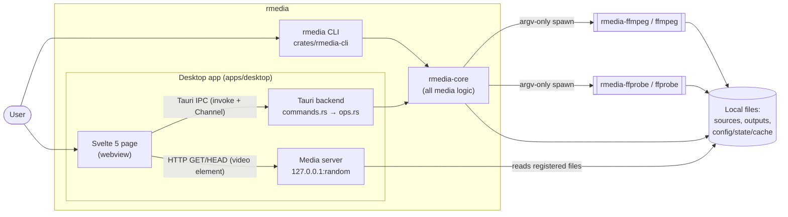
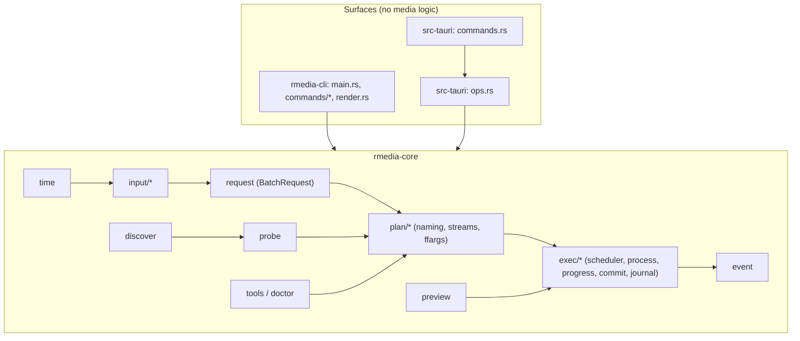
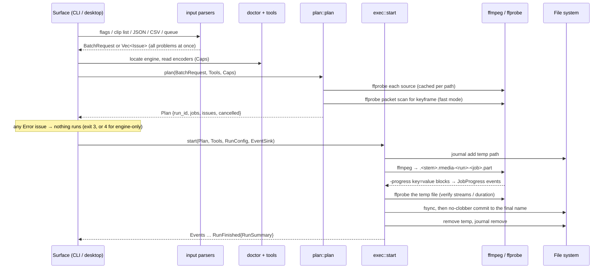

# rmedia Architecture Overview

**Status:** Feature 001 "Video Clipping Base" (version 0.1.0, commit `bd1eef8`) is described as
built. Feature 002 (user stories 1 to 6: `rmedia upscale` with the CPU, GPU and AI tiers, smart
reframe, the machine capability record, batch and `clip --upscale`, and the desktop upscale view;
unreleased, 0.2.0) is implemented and described under
[Feature 002 foundations](#feature-002-foundations-implemented) and in the
[Domain Breakdown](domains.md#upscaling-feature-002). Feature 003 (GIF export: `rmedia gif`,
`clip --gif`, `batch --gif` and the desktop GIF view; 0.3.0 in development) is implemented and
described under [Feature 003 GIF Export](#feature-003-gif-export-implemented-unreleased) and in the
[Domain Breakdown](domains.md#gif-export-feature-003). See the [Roadmap](../roadmap.md).

## Overview

rmedia cuts clips from local video files on Linux and Windows. It has one Rust core library,
`rmedia-core`, that owns all media logic. Two thin surfaces sit on top of it: the `rmedia`
command-line tool and a Tauri 2 / Svelte 5 desktop app. Neither surface links FFmpeg. The core
runs `ffmpeg` and `ffprobe` as child processes with argument vectors and parses their output.

Audience: engineers changing the code, reviewers, and security reviewers. For the per-module
breakdown, see [Domain Breakdown](domains.md). For interfaces, see the
[CLI reference](../api/cli-reference.md), [file formats](../api/file-formats.md),
[JSON output](../api/json-output.md) and [desktop IPC](../api/desktop-ipc.md).

## System Boundaries

In scope:

- `crates/rmedia-core` — timestamps, input parsing, discovery, probing, planning, execution,
  previews, settings.
- `crates/rmedia-cli` — the `rmedia` binary (clap).
- `apps/desktop` — Tauri backend (`src-tauri/`) and Svelte frontend (`src/`).
- `crates/rmedia-testkit` — test fixtures generated with FFmpeg at test time.
- `xtask` — build tooling (engine fetch, bindings, notices, CLI staging).

External, not owned here:

- **FFmpeg / ffprobe** (version 6.0 or later). Installers ship a pinned GPL build from
  BtbN/FFmpeg-Builds renamed `rmedia-ffmpeg` / `rmedia-ffprobe` (`xtask/tools.lock.json`).
- **The system webview**: WebKitGTK on Linux (which plays media through GStreamer), WebView2 on
  Windows.
- **The user's file system**: source videos, output folders, per-user config, state and cache
  folders.

There are no network services, accounts or telemetry (spec.md › Assumptions). The only listening
socket is the desktop app's loopback media server. See
[Media server](#preview-in-the-desktop-app-r8).

## System Context

The diagram shows the user driving either the CLI or the desktop page. The page talks to the
Tauri backend over IPC and loads video through the loopback media server. The CLI and the Tauri
backend both call `rmedia-core`. Only the core spawns FFmpeg tools, and FFmpeg reads sources and
writes temporary outputs.

## Components: One Core, Thin Surfaces

Constitution Principle I requires all media logic to live in one core library. The CLI and the
desktop app adapt input and output only.

| Component | Responsibility | Source |
|---|---|---|
| `rmedia-core` | Time grammar, request model, clip-list / manifest parsers, discovery, ffprobe parsing, planning, ffmpeg argv building, scheduler, process control, commit, journal, previews, settings; upscaling (002) and GIF export (003, `gif/`) | `crates/rmedia-core/src/` |
| `rmedia` CLI | clap argument parsing, input expansion, rendering (progress bars or JSON), Ctrl-C handling, exit codes | `crates/rmedia-cli/src/` |
| Tauri commands | Argument plumbing only | `apps/desktop/src-tauri/src/commands.rs` |
| Desktop ops | Path policy (`Allowed`), engine cache, plan/run registries, preview glue; tested without a webview | `apps/desktop/src-tauri/src/ops.rs` |
| Media server | Loopback HTTP range server for `<video>` | `apps/desktop/src-tauri/src/media_server.rs` |
| Svelte frontend | Sources, player, queue, run panel, settings; the queue is a v1 manifest | `apps/desktop/src/` |
| `rmedia-testkit` | lavfi fixtures, ffprobe assertions, PSNR helpers (`publish = false`) | `crates/rmedia-testkit/src/lib.rs` |
| `xtask` | `fetch-tools`, `pin-tools`, `pin-gif-tools`, `check-release-gate`, `gen-bindings`, `stage-cli`, `notices` | `xtask/src/main.rs` |

The diagram shows both surfaces calling into `rmedia-core`. In the desktop app, `commands.rs`
hands each call to `ops.rs`. Inside the core, time parsing feeds the input parsers, which build the
request. The request, probe results (fed by discovery) and engine capabilities (`tools` /
`doctor`) feed planning. Planning and `preview` both feed execution, which emits events.

The CLI crate depends on `rmedia-core` and on presentation crates (`clap`, `indicatif`,
`serde_json`) (`crates/rmedia-cli/Cargo.toml`). The desktop crate is a separate Cargo workspace
(`[workspace]` in `apps/desktop/src-tauri/Cargo.toml`) because it needs webkit2gtk to build. It
depends on `rmedia-core` by path.

## Process Model

rmedia never links libav. Every media operation is an `ffmpeg` or `ffprobe` child process
(research.md R2). The optional GIF engines, gifsicle and gifski (003), are child processes too,
as is the AI worker `rmedia-sr` (002). All long-running children go through `exec::process`
(`crates/rmedia-core/src/exec/process.rs`):

| Platform | Mechanism | Effect |
|---|---|---|
| Unix | `process_wrap::ProcessGroup::leader()` | Each child leads its own process group. Terminal Ctrl-C does not reach it directly, and cancel kills the whole group. |
| Linux | `PR_SET_PDEATHSIG(SIGKILL)` set in `pre_exec`, plus a `getppid()` race check | The child dies if rmedia is SIGKILLed. PDEATHSIG fires when the *spawning thread* exits, so children are spawned only from long-lived Tokio worker threads, never from `spawn_blocking`. |
| Windows | `process_wrap::JobObject` + `CREATE_NO_WINDOW` | The child runs in a Job Object, and no console window opens. Kill-on-close behaviour is described in research.md R7. **Unverified:** the validation record marks Windows Job Object cancellation as exercised only in CI (`checklists/validation.md` › Open items). |
| All | `KillOnDrop` | Dropping a running future kills the child (used by probe timeouts and scan cancellation). |

Other process rules:

- stdin is `/dev/null` (`Stdio::null()`). stdout is piped: ffprobe JSON is captured with a 16 MiB
  cap, and ffmpeg `-progress pipe:1` is read line by line. stderr keeps the last 50 lines, each
  cut to 4,096 characters, for error messages.
- On cancel the process tree is killed at once. There is no graceful `q`, because partial output
  is discarded anyway (research.md R7).
- `ffprobe` calls time out after 60 s (`probe::PROBE_TIMEOUT`).
- Short synchronous calls (`ffmpeg -version`, `ffmpeg -encoders`) use `tools::quiet_command`,
  which also sets `CREATE_NO_WINDOW` on Windows.

## Key Data Flow: Request → Plan → Exec → Commit

Every surface builds the same normalized `BatchRequest` and then follows one pipeline.

1. **Request.** CLI flags (`commands/clip.rs`), clip lists (`input/cliplist.rs`), JSON or CSV
   manifests (`input/manifest_json.rs`, `input/manifest_csv.rs`) and the desktop queue (a v1
   manifest parsed by `manifest_json::from_value`) all produce a `BatchRequest`
   (`request.rs`). Parsers report every problem with its origin: file and line, or file and
   JSON path.
2. **Plan.** `plan::plan` (`plan/mod.rs`) probes each source once and validates times. It then
   chooses the container and encode profile, selects streams, renders the output name, refuses
   any output that equals a source, resolves collisions, and computes the seek plan. It writes
   nothing. The output is a `Plan` of `PlannedJob`s, each with a `Disposition` of `run` or
   `skip`, plus a list of `Issue`s.
3. **Exec.** `exec::start` (`exec/mod.rs`) runs jobs under a semaphore. The default is half the
   CPU cores, clamped to 1–4 (`exec::default_jobs`). It emits `Event`s to an `EventSink`. The
   CLI renders them; the desktop app forwards them over a Tauri `Channel`.
4. **Commit.** After ffmpeg exits successfully, `exec/clip.rs` re-probes the temp file. It checks
   the stream count and, in accurate mode, that the video length matches the request within
   3 frames + 100 ms. `exec/commit.rs` then fsyncs and moves the file into place according to
   the `--on-exists` policy.

## Design Decisions

| Decision | Rationale | Evidence |
|---|---|---|
| Rust workspace, clap CLI, Tauri **2.x** desktop app | One core with no IPC between surfaces. `process-wrap` gives child-process control on both OSes. Tauri bundles NSIS/MSI/AppImage/deb. Tauri 3 was alpha at planning time. | research.md R1; `research/04-app-stack-and-packaging.md` |
| FFmpeg as subprocesses, never linked | Crash isolation, full CLI semantics, simple GPL boundary | research.md R2 |
| Paths passed as `file:<path>` plus `-protocol_whitelist file,pipe` | `-x.mp4` or `a:b.mp4` can never be read as an option or protocol, and playlists cannot make FFmpeg fetch network URLs | `probe::file_arg`, `probe::INPUT_PROTOCOLS` |
| Explicit `-f <muxer>` | Temp outputs end in `.part`, so FFmpeg cannot infer the muxer | `plan/streams.rs` `Container::muxer` |
| App computes durations (`-t`), never output `-to` | Timing must not depend on how FFmpeg relates `-ss` to `-to` | research.md R3 |
| JSON + CSV manifests; no YAML/TOML | JSON round-trips with the desktop app and avoids the YAML 1.1 sexagesimal trap (`1:30` → 90). CSV is spreadsheet-friendly. | research.md R5 |
| No persistent probe cache in v1 | 1,000 probes at ~50 ms on 8 workers ≈ 7 s, well under the 60 s target. Measured 6.3 s for 10k files / 1k videos. | research.md R6; `checklists/validation.md` SC-003 |
| In-flight journal | A killed process would otherwise leave `.part` files forever | research.md R7; plan.md Complexity Tracking |
| Loopback media server for playback | WebKitGTK reported `MEDIA_ERR_SRC_NOT_SUPPORTED` for every codec via `asset://` | research.md R8 spike |

### Seek Strategy (research.md R3)

Demuxer seeking is exact only for indexed containers. The planner decides from ffprobe's
`format_name` (`MediaInfo::has_indexed_seeking`: `mov`, `mp4`, `matroska`, `webm`), not from the
file extension. A mislabelled MPEG-TS named `.mp4` therefore still gets the safe strategy.

| Mode | Indexed source (MP4/MOV/MKV/WebM by `format_name`) | Other (MPEG-TS/PS, AVI, …) |
|---|---|---|
| fast (stream copy) | Input `-ss S`. Lands on keyframe K ≤ S. | No demuxer seek. Output `-ss` at K − min(4 frames, ½ GOP). Leading non-keyframes are dropped, so the output starts exactly on K. |
| accurate (re-encode) | Input `-ss S` (frame exact) | `-copyts` + coarse input `-ss S − 10 s` + `trim`/`atrim` filters at absolute source times. Subtitles are dropped with a warning. |

Supporting rules from `plan/mod.rs` and `probe.rs`:

- K is found by scanning video packets in a window before S. The window is 12 s, widened to 65 s
  if needed (`probe::keyframe_at_or_before`). K is never taken from where the demuxer lands. If no
  keyframe is found, the planner reports an error suggesting `--mode accurate`.
- **Zero point:** user time 0 is the first video frame (`MediaInfo::zero_point`). Every emitted
  `-ss` is shifted by `zero_point − container start_time`.
- A clip starting at 0 uses no seek at all.
- Fast mode reports `predicted.start = K`. The run reports `actual` and sets `adjusted` when start
  or end differ from the request by more than 50 ms (FR-014).
- Accurate-mode encode profiles (research.md R4, `plan/streams.rs`): mp4/m4v/mov/mkv/ts use
  libx264 CRF 18, preset medium, yuv420p, an even-dimension crop, and AAC 192k. webm uses
  libvpx-vp9 CRF 24 and libopus 160k. Other containers fall back to mp4 with a warning.

### Preview in the Desktop App (R8)

Playback is served from an in-process HTTP server bound to `127.0.0.1` on an ephemeral port. URLs
have the form `http://127.0.0.1:<port>/<token>/<id>`, where the token is 128-bit and random per
launch and the id is opaque and per file. The fallback chain is: direct play (MP4/MOV with
H.264 + AAC, or WebM with VP8/VP9/AV1 + Opus/Vorbis) → 480p H.264 proxy → VP8/WebM proxy →
still frames (`frame_at`). Proxies keep source timestamps (`-fps_mode passthrough`), and
`clip time = currentTime − time_offset`. Proxies and thumbnails are cached under the user cache
folder, keyed by SHA-256 of canonical path + size + mtime, with LRU eviction. The default cap is
5,120 MB (`Settings::proxy_cache_max_mb`). Security controls and residual risks are covered in the
[Security Model](../security/security-model.md).

## Data Model / Storage

rmedia stores files only (plan.md › Technical Context). Directories come from
`directories::ProjectDirs::from("com", "OpenLogic", "rmedia")` (`settings.rs`):

| Data | Location | Notes |
|---|---|---|
| Desktop settings | `<config dir>/settings.json` (override: `RMEDIA_CONFIG_DIR`) | Saved atomically (temp file + rename). Unknown fields are rejected. A missing or invalid file yields defaults. |
| Crash journal | `<state dir>/inflight/<run_id>-<pid>.json` (override: `RMEDIA_STATE_DIR`). Falls back to the local data dir where the platform has no state dir. | JSON array of absolute temp paths. Directory mode `0700` on Unix. |
| Preview cache | `<cache dir>/preview/` | Proxies `<key>-proxy.mp4|webm`, thumbnails `<key>-thumb<n>-<i>.jpg` |
| Temp outputs | `<output dir>/.<stem>.rmedia-<run_id>-<job>.part` | Hidden, and skipped by discovery |

On Linux the state and cache folders resolve to `~/.local/state/rmedia/` and `~/.cache/rmedia/`
(observed on a development machine). **Unverified:** the Windows folders follow the `directories`
crate's conventions and were not checked on a Windows machine. See
[Configuration › File locations](../administration/configuration.md#file-locations).

## Failure Domains

| Failure | Blast radius | Handling |
|---|---|---|
| One ffmpeg job fails | That job only | `JobOutcome::Failed{error{code,…}}`. Other jobs continue. Exit code 1 (FR-020, SC-004). |
| A job task panics | That job only | Reported as `Failed` with code `INTERNAL`, and its temp file is removed (`exec/mod.rs`) |
| User cancels | Run or single job | Child process tree killed, temp removed, `Cancelled` outcome. Exit 130 when the whole run was cancelled. |
| rmedia killed (SIGKILL / crash) | Running children and temp files | Children die via PDEATHSIG or Job Object. The next run's `journal::purge_stale` removes the dead run's temp files. |
| Output appears during the job | That job | No-clobber commit fails with `AlreadyExists` → `Skipped` ("output appeared while the clip was being made") |
| Engine missing / too old / missing encoder | Whole invocation, or accurate clips only | `ENGINE_MISSING`, exit 4. A missing encoder is a plan-time error that names the encoder. |
| Webview cannot play a codec | Desktop preview only | Fallback chain ends in still frames. Clips are always cut from the original. |

## Scaling

The design targets a single user with local files, batches of hundreds of clips, and trees of
10k+ files (plan.md). Concurrency is the `-j` semaphore (1–64 accepted by the CLI; default
clamp(ncpu/2, 1, 4)). Discovery probes with a fixed pool of min(available parallelism, 16)
ffprobe tasks. Progress events are throttled: about 10 Hz per job (100 ms) and 4 Hz for
`run_progress` (250 ms).

## Feature 002 Foundations (Implemented)

The scheduler does not inspect job kinds: `JobSpec` variants run through `JobCtx`
(`exec/mod.rs`). `JobSpec` now has two variants, `Clip(ClipSpec)` and `Upscale(UpscaleSpec)`.
The upscale job is one ffmpeg pass (`upscale/graph.rs` builds the `-filter_complex`) followed by a
verify stage (`exec/upscale.rs`). Device presets are data (`preset/`): seven built-ins compiled
into the binary plus user files in `<config>/presets/`.

## Feature 003 GIF Export (Implemented, Unreleased)

`JobSpec` has a third variant, `Gif(Box<GifSpec>)`. A GIF job runs analyze (smart framing only),
a bounded size-budget search over sample encodes, a two-pass palette encode (or the ffmpeg →
gifski pipe, or the MP4 encode), an optional gifsicle post-pass and a verify stage
(`exec/gif.rs`), reusing 002's frame chain, reframe analysis, scratch folders, events and commit.
GIF targets are data (`gif/target.rs`, four built-ins plus `<config>/gif-targets/`). See
[Domain Breakdown › GIF Export](domains.md#gif-export-feature-003) and the
[0.3.0 release notes](../releases/0.3.0-dev.md).

## Job-Kind Refactors

Feature 002 is implemented: user stories 1 to 6 (CPU tier, smart reframe, GPU tier and
capability record, batch and `clip --upscale`, the desktop upscale view, and the AI tier with
its `rmedia-sr` worker). See [Domain Breakdown › Upscaling](domains.md#upscaling-feature-002).
Feature 003 added refactor B3: `exec/pipeline.rs` runs N stages joined by pipes (the AI tier's
three, and ffmpeg → gifski).

**Refactors before adding job kinds** (plan.md, senior review A1–A5, 2026-10-06). All five were
completed on 2026-10-14 as part of 002 phase 2 (tasks T007 to T021); the first table below
is kept as the record of what each one was. The "Current state" column describes the code as it
was before then (0.1.0).

| ID | Refactor | State in 0.1.0 (before the refactor) |
|---|---|---|
| A1 | Move clip-specific fields (`requested`/`predicted`, `mode`, `media_len`) into `ClipSpec`. `JobOutcome::Succeeded` carries a `JobMeasure` enum instead of a clip `Span`. | `PlannedJob` and `JobOutcome::Succeeded` still carry clip spans |
| A2 | Multi-stage jobs: a job-kind `execute(&mut JobCtx)` that can run several processes. `JobCtx` offers `scratch_dir()` and journals every intermediate file. | `JobCtx` exposes one `temp`. Only `job.temp` is journaled. |
| A3 | Weighted multi-stage progress; per-resource (GPU vs CPU) semaphores | One `Semaphore` for all jobs |
| A4 | `Caps` grows filters/hwaccel/GPU/model availability; issue codes become a typed enum | `Caps { encoders }` only. `Issue.code` is `&'static str`. |
| A5 | Extract output resolution, claiming and collision handling from `plan_clip` | Inline in `Planner::plan_clip` |

## Related Documentation

- [Domain Breakdown](domains.md)
- [Security Model](../security/security-model.md)
- [CLI Reference](../api/cli-reference.md) · [File Formats](../api/file-formats.md) ·
  [JSON Output](../api/json-output.md) · [Desktop IPC](../api/desktop-ipc.md)
- [Release Notes 0.1.0](../releases/0.1.0.md) · [Glossary](../reference/glossary.md)
- Sources: `specs/001-video-clipping/{plan.md,research.md,data-model.md}`,
  `.specify/memory/constitution.md`
