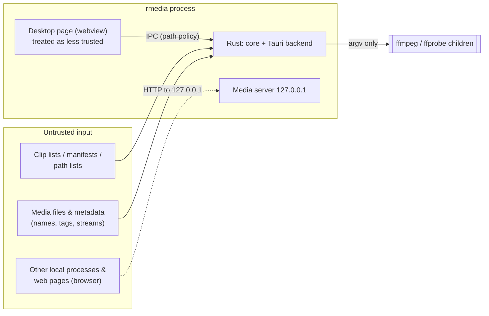

# rmedia Security Model

**Status:** Current (0.1.0, commit `bd1eef8` plus the later desktop settings/export fixes).

This page describes what rmedia protects, which threats it considers, the controls in the code,
and the risks that remain. Sources: `specs/001-video-clipping/research.md` R2, R7, R8 and R9; the
security-review commits `c5fb784` and `d63d63d`; and the code cited in each section. Claims about
Windows behaviour are marked where they rest on CI only.

## Assets

| Asset | Why it matters |
|---|---|
| Source videos | Constitution Principle V: never modified, moved or deleted |
| Existing files in output folders | Must not be overwritten unless the user chose `overwrite` |
| Arbitrary user files (home folder, credentials, documents) | Must not be readable through the desktop page or the media server |
| The user's machine | No unintended programs run; no orphaned processes |
| Integrity of the bundled engine | rmedia executes it |

## Trust Boundaries and Threats

Untrusted inputs reach the Rust side either directly (media files and their metadata, clip lists,
manifests, path lists) or through the webview page over IPC. The page is treated as less trusted
than the Rust side. Other local processes and web pages in the user's browser can reach the media
server over loopback HTTP. The Rust side starts ffmpeg/ffprobe children with argument vectors
only.

| # | Threat | Considered in |
|---|---|---|
| T1 | Crafted file names (`-x.mp4`, `a:b.mp4`, names with newlines or ANSI escapes) interpreted as options, protocols, extra list entries, or terminal control sequences | R2, `c5fb784` |
| T2 | Media or playlists that make FFmpeg fetch network URLs or read other local files | `probe::INPUT_PROTOCOLS` |
| T3 | Output paths that clobber sources or existing files, or escape the output folder | Principle V, FR-018 |
| T4 | A pre-planted symlink at a predictable temp path, or a journal entry that points elsewhere, used to delete or overwrite a victim file | `plan::new_run_id`, `exec/journal.rs` |
| T5 | A compromised or injected desktop page reading arbitrary files, writing outside chosen folders, or running an arbitrary executable | R8 #11, `d63d63d` |
| T6 | Other local processes or browser pages reading files through the media server (DNS rebinding, cross-origin requests, id enumeration, symlink swap) | R8 #1–#12 |
| T7 | Resource exhaustion from hostile files or huge trees | `exec/process.rs`, `discover.rs` |
| T8 | Supply-chain compromise of the bundled FFmpeg, Rust crates or npm packages | R9 |

## Controls

### Process Spawning (T1, T2)

- **Argument vectors only.** No shell is ever used: `tokio::process::Command` / `std::process::Command`
  with `args` (`exec/process.rs`, `tools.rs`). Constitution Principles IV and V.
- **`file:` prefix.** Every input and output path is passed as `file:<path>` (`probe::file_arg`),
  so a leading `-` or an embedded `:` cannot be read as an option or protocol.
- **Protocol whitelist.** Every ffmpeg and ffprobe input carries `-protocol_whitelist file,pipe`.
  HLS, concat or SDP inputs that reference network URLs cannot make the engine fetch anything.
  The planner also refuses `.m3u8`, `.m3u`, `.ffconcat` and `.sdp` sources outright
  (`plan/mod.rs`).
- **No stdin, no overwrite by ffmpeg.** `-nostdin`, stdin set to null, and `-n` on clip jobs:
  ffmpeg itself never overwrites (`plan/ffargs.rs::common_args`). The preview proxy uses `-y`, but
  only on its own `.part` file in the cache folder.
- **Bounded output.** ffprobe stdout is capped at 16 MiB, stderr keeps the last 50 lines of at
  most 4,096 characters, and ffprobe times out after 60 s (`exec/process.rs`, `probe.rs`).
- **Child lifetime.** Process group plus `PR_SET_PDEATHSIG(SIGKILL)` on Linux, Job Object plus
  `CREATE_NO_WINDOW` on Windows, and kill-on-drop everywhere (see the
  [Architecture Overview](../architecture/overview.md#process-model)). SIGINT and SIGKILL with no
  orphans are verified on Linux (`tests/cancel.rs`, `clip_single.rs`). **Unverified:** Windows Job
  Object cancellation is exercised only in CI (`checklists/validation.md`).
- **Terminal output.** Untrusted text such as file names and rejection details is printed with
  control characters replaced (`render::clean`). `scan --paths` skips names containing line breaks
  or invalid UTF-8, so a hostile name cannot inject entries into `clip --inputs-from -`.
- **Engine executable.** Explicit engine paths are canonicalized. In the desktop app, only a
  native file picker in Rust can change them; `set_settings` ignores engine paths from the page.

### Inputs Are Sacred: Output Safety (T3, T4)

- The planner refuses an output equal to any canonical source path. It resolves symlinked folders
  by canonicalizing the nearest existing ancestor (`Planner::is_source`). Path comparison is
  case-insensitive on Windows (`discover::path_key`).
- Name templates cannot produce absolute paths or `.`/`..` components, and placeholder values
  cannot add separators (`plan/naming.rs`).
- ffmpeg writes only to a hidden temp file, `.<stem>.rmedia-<run_id>-<job>.part`, next to the
  final output. `run_id` comes from a hasher keyed by the OS RNG, so temp names cannot be
  predicted and pre-planted.
- **No-clobber commit** (`exec/commit.rs`): the temp file is fsynced, then `hard_link` creates the
  output and fails atomically if it already exists. Where hard links are unavailable, the name is
  reserved with `create_new` before renaming. An output that appears mid-job becomes a `skipped`
  outcome, not a lost file. Overwrite happens only with an explicit `--on-exists overwrite`.
- Every finished, failed or cancelled job removes its temp file. Windows sharing violations are
  retried 10 times at 100 ms intervals.
- **Journal guards** (`exec/journal.rs`): the journal folder is created with mode `0700` on Unix.
  A journal is purged only when its OS file lock can be taken, meaning the owner is dead. Purging
  deletes only entries that are absolute, named exactly `.<stem>.rmedia-<that run_id>-<digits>.part`,
  and regular files; symlinks are never followed or deleted. Unit tests cover lookalike names,
  other runs' files, relative paths and symlinked entries.
- Discovery never descends into rmedia's own output folders on `clip` re-runs, and refuses `-o`
  equal to a scanned folder (`commands/scan.rs`).

### Desktop Page Containment (T5)

- **Capabilities:** the window has only `core:event:allow-listen` and
  `core:event:allow-unlisten`. There are no fs, shell or dialog permissions for the page, and
  dialogs run in Rust (`capabilities/default.json`).
- **Configuration:** `withGlobalTauri: false`; asset protocol disabled; CSP `default-src 'self'`,
  `script-src 'self'`, `connect-src ipc: http://ipc.localhost`, `media-src http://127.0.0.1:*`,
  `img-src 'self' data: blob: http://127.0.0.1:*` (upscale preview stills, 002 US5),
  `object-src 'none'`, `frame-ancestors 'none'` (`tauri.conf.json`).
- **Path policy** (`ops::Allowed`): every path-taking command requires a user-chosen path, then
  works on the canonical path it checked, so there is no check/use race on links. Clip lists and
  manifests must be picked as such. A manifest grants access only to the existing video files it
  names. Exports go only to the Save-dialog path. Clip outputs must lie inside a picked folder or
  next to the source. Details: [Desktop IPC › Path policy](../api/desktop-ipc.md#path-policy).
- **Saved output folder:** `set_settings` accepts a changed `defaults.output_dir` only if it is
  already allowed (picked with the folder dialog), so the page cannot name an arbitrary write
  target. At startup the saved folder is re-allowed (`AppState::new`); this trusts `settings.json`,
  which only the user (or a process running as the user) can edit.
- Tests: `src-tauri/tests/bridge.rs` (`only_user_chosen_paths_are_usable`,
  `settings_from_the_page_cannot_set_engine_paths`, `outputs_lists_and_manifests_are_confined`,
  `export_carries_settings_defaults_and_saved_output_survives_restart`).
- Untrusted media metadata is rendered as text, never as `innerHTML` (research.md R8). No `@html`
  or `innerHTML` usage was found in `apps/desktop/src/lib/components/`.

### Media Server

Requirements R8 #1–#12 came from the security-auditor review (2026-10-06). Implementation:
`apps/desktop/src-tauri/src/media_server.rs`.

| Requirement | Implementation |
|---|---|
| Loopback only, ephemeral port, fail closed | `TcpListener::bind(("127.0.0.1", 0))`; app setup fails if binding fails |
| Session token | 128-bit `getrandom` token in the URL path, constant-time compare, new per launch; all ids revoked on window close; redacted from `Debug` |
| Opaque ids | Random 128-bit id → canonical path, registered only by `preview_source` / `ensure_proxy`; URLs carry no paths; unknown id → 404 |
| Per-request file checks | The registered path must still canonicalize to itself. The file is opened with `O_NOFOLLOW` (Unix) or `FILE_FLAG_OPEN_REPARSE_POINT` (Windows), must be a regular file, and is served from that handle. |
| Methods and ranges | GET/HEAD only (else 405); a single `bytes=` range, clamped; 416 when invalid; streamed in 128 KiB chunks |
| DNS rebinding / cross-site | `Host` must equal `127.0.0.1:<port>`. `Origin`, if present, must be the app origin. No `Access-Control-Allow-Origin`. |
| Headers | `X-Content-Type-Options: nosniff`, `Cache-Control: no-store`, `Cross-Origin-Resource-Policy: cross-origin` (needed for the app origin to load media from 127.0.0.1), and `Content-Type` from a fixed video map, else `application/octet-stream` |
| Limits | At most 8 concurrent connections (excess connections are dropped), 8 KiB header cap, 10 s header timeout, 30 s write timeout, one request per connection; tolerates files shrinking mid-stream |
| Scope | Serves only user-chosen sources and cache proxies; never outputs, temp files or the journal |
| Tests | `src-tauri/tests/media_server.rs`: missing/wrong token, traversal, symlink swap, bad Host/Origin, ranges, loopback-only binding |

### Supply Chain (T8)

- The FFmpeg build is pinned by URL and SHA-256 in `xtask/tools.lock.json` (BtbN
  `autobuild-2026-10-05-13-07`, `n9.0.2-22-g46d8f462ee`, GPL). `cargo xtask fetch-tools`
  verifies the archive hash and records the binaries' hashes in a stamp file. The binaries are
  never committed.
- `deny.toml` (cargo-deny): yanked crates denied, a license allowlist, wildcard versions denied,
  unknown registries and git sources denied.
- CI actions are pinned to full commit SHAs. Checkout uses `persist-credentials: false`, and
  workflow permissions are `contents: read`. A weekly scheduled CI run catches new advisories.
- `THIRD_PARTY_NOTICES.md` is generated by `cargo xtask notices` and covers both release
  platforms. The release workflow fails if it is stale. FFmpeg's GPL notice and source offer are
  in `licenses/FFMPEG-NOTICE.md`.
- The workspace denies `unsafe_code`. The only exception is `set_parent_death_signal`
  (`#[allow(unsafe_code)]`), whose `pre_exec` closure calls only `prctl` and `getppid`.

## Residual Risks

| Risk | Status | Source |
|---|---|---|
| The media server re-checks the canonical path and uses `O_NOFOLLOW` but does not compare device/inode against registration. A local attacker who can race a parent-folder swap could redirect a request. | Accepted for v1 | research.md R8, implementation status |
| CSP is static: `media-src` and `img-src http://127.0.0.1:*` (any port) and `style-src 'unsafe-inline'` (Svelte style attributes). It is not narrowed to the exact port at runtime, as R8 #11 required. | Accepted for v1. There is no script injection path, and `connect-src` is IPC only. | research.md R8 |
| Upscale view (002 US5): `models_dir` is set only through a Rust folder picker, but models found there are hashed into the analysis cache key, not pinned to a known hash. One analysis and one preview run at a time (a new one cancels the old one); times from the page are range-checked; preview URLs are capped at 48 and evicted stills are forgotten by the media server. | Accepted for v1 (models are parsed by pure-Rust tract, not executed) | `ops.rs`, `upscale/preview.rs` |
| Any local process that learns a media URL (token + id) can read that one registered file until the window closes | By design; the token is never logged | `media_server.rs` |
| BtbN builds are unsigned, and dated autobuild tags are pruned over time | Open: mirror the pinned archives to project-owned release storage before the first release | research.md R9 (audit M3) |
| No code signing for installers | Open owner decision | `checklists/validation.md` |
| The desktop page can register any allowed media file (including files under a picked folder) with the media server | Inherent to the path policy; limited to user-chosen locations | `ops.rs` |
| Windows-specific controls (Job Objects, reparse-point flag, cloud placeholders, long paths) | Type-checked locally; **Unverified** beyond CI | `checklists/validation.md` |
| `Settings::load` silently falls back to defaults on an unreadable or invalid file | Low impact (availability only) | `settings.rs` |

## Related Documentation

- [Architecture Overview](../architecture/overview.md)
- [Desktop IPC Reference](../api/desktop-ipc.md)
- [Release Notes 0.1.0](../releases/0.1.0.md)
